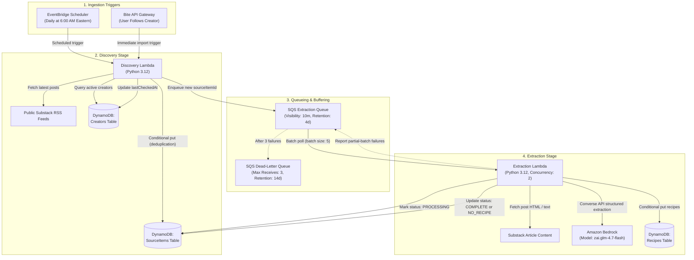

# Bite Event-Driven Pipeline

This document explains the event-driven ingestion and extraction pipeline used in Bite. The pipeline automates discovering new Substack newsletter posts, queueing extraction jobs, extracting structured recipes using Amazon Bedrock, and persisting records into Amazon DynamoDB.

---

## 1. Pipeline Overview

The pipeline has two main stages:

1. **Discovery Stage (EventBridge + Discovery Lambda)**: Identifies followed Substack publications, polls their public RSS feeds, deduplicates incoming posts, and places newly discovered items onto an SQS queue.
2. **Extraction Stage (SQS + Extraction Lambda + Bedrock)**: Consumes queue messages in batches, fetches the post article text, uses Amazon Bedrock to extract structured recipe data, and stores normalized recipe records.

---

## 2. Architecture Diagram

---

## 3. Component Breakdown

### A. Triggers (EventBridge & API)

Discovery can be triggered through two paths:

- **Daily Schedule**: An Amazon EventBridge Scheduler rule runs every morning at 6:00 AM America/New_York (`cron(0 6 * * ? *)`), invoking the Discovery Lambda with `{"scheduled": true}`.
- **On-Demand (Creator Follow)**: When a user follows a new creator in the Bite web client, the API Lambda can invoke the Discovery Lambda directly with `{"creatorId": "<id>"}` for an immediate import of recent posts.

### B. Discovery Lambda (`DiscoveryFunction`)

- **Runtime**: Python 3.12, 256 MB memory, 60-second timeout.
- **Process**:
  1. Queries the `Creators` table for active creators (or looks up the specific creator passed in the invocation payload).
  2. Fetches the publication's public RSS feed using standard HTTP GET.
  3. Iterates over the latest feed items (capped by `INITIAL_IMPORT_LIMIT`, default 20).
  4. Derives a deterministic `sourceItemId` using SHA-256: `sha256("substack|" + guid_or_url)`.
  5. Performs a conditional write (`attribute_not_exists(sourceItemId)`) to the `SourceItems` DynamoDB table with status `QUEUED`.
  6. If the item already exists, DynamoDB throws a `ConditionalCheckFailedException` and the item is skipped.
  7. If the write succeeds (new post), a message containing `{"sourceItemId": identifier}` is sent to the SQS Extraction Queue.
  8. Updates the creator record with `lastCheckedAt` and `lastSuccessfulCheckAt`.

### C. Extraction Queue & Dead-Letter Queue (SQS)

- **Extraction Queue**:
  - Visibility Timeout: 10 minutes (configured well above the Lambda function's 90-second timeout).
  - Message Retention: 4 days.
  - SQS-managed server-side encryption.
- **Dead-Letter Queue (DLQ)**:
  - Max Receive Count: 3 attempts.
  - Message Retention: 14 days.
  - Collects poison-pill messages or posts that fail repeatedly due to malformed HTML, repeated scraping timeouts, or Bedrock service issues.

### D. Extraction Lambda (`ExtractionFunction`)

- **Runtime**: Python 3.12 (x86_64), 512 MB memory, 90-second timeout.
- **Event Source Mapping**:
  - `batchSize`: 5 messages per invocation.
  - `maxConcurrency`: 2 parallel executions to prevent rate-limiting against Amazon Bedrock and DynamoDB.
  - `reportBatchItemFailures`: Enabled.
- **Process**:
  1. Receives a batch of SQS records.
  2. Updates the item status in `SourceItems` to `PROCESSING` and increments `attemptCount`.
  3. Downloads and cleans the post article text from the Substack source URL.
  4. Invokes the Amazon Bedrock Converse API with structured JSON output enforcement (`zai.glm-4.7-flash`).
  5. Bedrock extracts:
     - Recipe title and description
     - Normalized ingredients (raw string, name, quantity, unit, optional flag)
     - Clean, numbered instruction steps
     - Cook time, servings, tags, and extraction confidence score
  6. Generates deterministic recipe identifiers: `recipeId = sha256(sourceItemId + "|" + index)`.
  7. Writes recipe records to the `Recipes` table using conditional puts (`attribute_not_exists(recipeId)`).
  8. Updates `SourceItems` status to `COMPLETE` if recipes were found, or `NO_RECIPE` if the post did not contain recipe content.

---

## 4. Reliability and Error Handling Patterns

### 1. Deterministic Identifiers & Idempotency
All identifiers are derived deterministically:
- `creatorId`: `sha256(feed_url)`
- `sourceItemId`: `sha256("substack|" + guid_or_url)`
- `recipeId`: `sha256(sourceItemId + "|" + str(recipe_index))`

Because DynamoDB writes use `attribute_not_exists`, repeating discovery or re-running extraction will never create duplicate source items or duplicate recipes.

### 2. Partial-Batch Failure Handling (`reportBatchItemFailures`)
The SQS event source mapping uses `ReportBatchItemFailures`. If 1 out of 5 messages in a batch fails:
- The Lambda function logs the exception and returns `{"batchItemFailures": [{"itemIdentifier": "<messageId>"}]}`.
- SQS deletes the 4 successfully processed messages.
- Only the single failed message becomes visible again after the visibility timeout expires.

### 3. Concurrency Throttling & Protection
Setting `maxConcurrency: 2` on the SQS event source mapping prevents extraction bursts from exhausting Amazon Bedrock quota or causing DynamoDB write throttling during large initial creator imports.

### 4. Dead-Letter Queue (DLQ) Isolation
If an article consistently crashes the extractor or parser across 3 attempts, SQS routes the message to the DLQ for manual inspection without blocking subsequent items in the queue.

---

## 5. Summary Table of AWS Resources

| Resource | Service | Key Settings |
| :--- | :--- | :--- |
| `DailyDiscoverySchedule` | Amazon EventBridge Scheduler | `cron(0 6 * * ? *)`, America/New_York |
| `DiscoveryFunction` | AWS Lambda (Python 3.12) | 256 MB memory, 60s timeout |
| `ExtractionQueue` | Amazon SQS | Visibility 10m, Retention 4d, Max receive count 3 |
| `ExtractionDeadLetterQueue` | Amazon SQS | Retention 14d |
| `ExtractionFunction` | AWS Lambda (Python 3.12) | 512 MB memory, 90s timeout, Concurrency limit 2 |
| `Model: zai.glm-4.7-flash` | Amazon Bedrock | Converse API with structured JSON output schema |
| `SourceItemsTable` | Amazon DynamoDB | PK: `sourceItemId`, GSI: `creatorId-publishedAt-index` |
| `RecipesTable` | Amazon DynamoDB | PK: `recipeId`, GSI: `creatorId-publishedAt-index` |
| `CreatorsTable` | Amazon DynamoDB | PK: `creatorId` |
